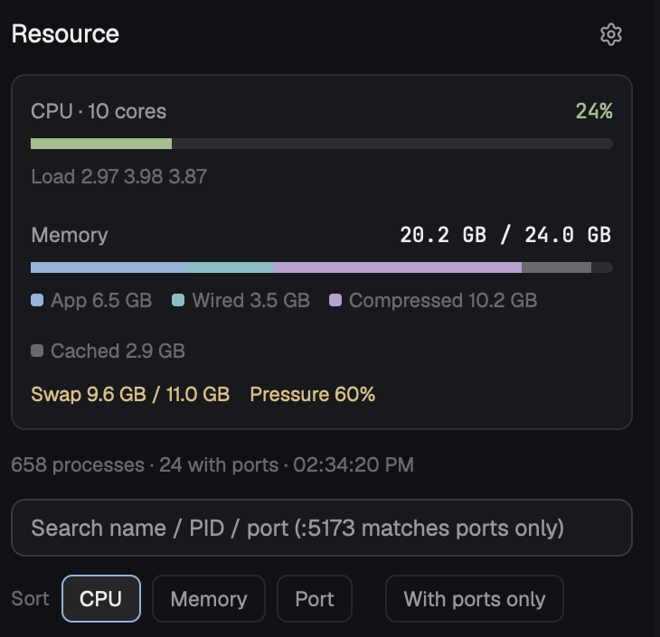

# Resource — a Herdr mod

A side panel for [Herdr](https://herdr.dev) that shows CPU and memory use and
every process with the ports it listens on. Search by name, PID or port, then
terminate or force kill. macOS, Linux and Windows; English and 繁體中文.



## Install

Ask the agent in your Herdr window:

> Add the mod github.com/chuangmaster/herdr-resource-monitor

Or copy it yourself:

```sh
git clone https://github.com/chuangmaster/herdr-resource-monitor
cp -R herdr-resource-monitor/mods/resource-monitor ~/.config/herdr-app/mods/
herdr-app check ~/.config/herdr-app/mods/resource-monitor
```

Then open it from the command palette (`mod.open`, name `resource-monitor`) or:

```sh
herdr-app do mod.open --name resource-monitor
```

To get a "Resource" button in the tab bar that opens it as a side panel, see
"Optional: a button in the tab bar" in [RECIPE.md](RECIPE.md).

## Use

- Type to filter by name, PID or port; `:5173` matches ports only.
- Sort by CPU, memory or port; "With ports only" hides the rest.
- Click a process, then **Terminate** (SIGTERM / `taskkill`) or
  **Force kill** (SIGKILL / `taskkill /F`).
- The gear sets the language and how often it refreshes (1–30 s, or paused).

## What it runs

It's a trusted Herdr mod: it runs local programs, never the network.

- macOS: `ps`, `lsof`, `vm_stat`, `sysctl`
- Linux: `sh -c` reading `/proc`, `ps`, `nproc`, `ss` (or `lsof`)
- Windows: `powershell.exe` (`Get-Process`, `Get-NetTCPConnection`,
  `Get-NetUDPEndpoint`, CIM), `taskkill`
- Terminate / Force kill: `kill` or `taskkill`, only when you press them.

Ports and kills of other users' processes need root / an elevated shell.

## Develop

```sh
npm test   # Node 20+: parser tests against real macOS and Linux output
```

`parse.js` holds every parser and has no Herdr imports, so it runs under Node.
Linux is tested against real output from a Debian container; Windows only
against hand-written JSON in the shape the PowerShell script prints, so
reports from Windows users are welcome.

---

# Resource — Herdr 模組

在 [Herdr](https://herdr.dev) 側邊顯示 CPU、記憶體用量，以及每個 process 和它監聽的
port。可以用名稱、PID 或 port 搜尋，再終止或強制終止。支援 macOS、Linux、
Windows，介面有英文與繁體中文。

安裝：在 Herdr 視窗裡跟 agent 說「Add the mod
github.com/chuangmaster/herdr-resource-monitor」，或把
`mods/resource-monitor` 複製到 `~/.config/herdr-app/mods/`，再用
`herdr-app do mod.open --name resource-monitor` 開啟。語言與更新頻率在右上角齒輪裡設定。
