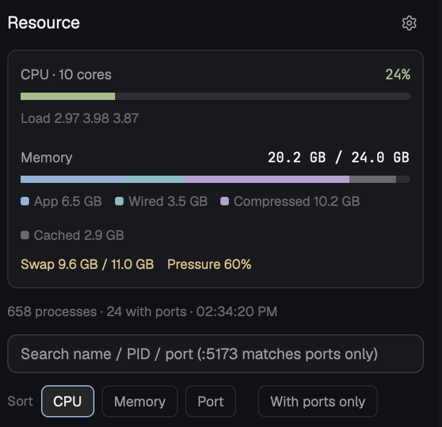

# Resource

A panel for Herdr that shows how busy this computer is and what is running on
it. At the top, a card with CPU use (with load average) and memory use split
into its parts, swap, and memory pressure. Below it, every process with its
CPU, memory and the ports it listens on. Type to find a process by name, PID
or port, click it, then terminate or force kill it. Works on macOS, Linux and
Windows; English and 繁體中文.



## What you see

Top to bottom, in one column on the theme's `chrome` background, 12 px
padding, 10 px gaps, UI text 12.5 px:

- **Header row:** "Resource" (14 px, semibold, `foreground`) on the left; a
  24 px gear button (`mods/workspace-chrome/settings.svg`, 14 px, `muted`,
  `selected` background while open) on the right.
- **Settings card** (only while the gear is on): `surface` background, 1 px
  `border`, radius 8, padding 10. Three rows, each with a 72 px `dim` label:
  Language (`English`, `繁體中文` chips), Refresh every (1s, 2s, 3s, 5s, 10s,
  30s, Paused chips) and a "↻ Refresh now" button.
- **Overview card:** `surface`, 1 px `border`, radius 8, padding 10.
  - "CPU · N cores" with the percent on the right in mono; a 6 px bar
    (radius 3, `raised` track). Color by level: `ansi2` (green) below 60%,
    `ansi3` (yellow) from 60%, `ansi1` (red) from 85%. Under it "Load a b c"
    (11 px, `dim`) where the platform has a load average.
  - "Memory" with "used / total" on the right; a segmented 6 px bar and a
    legend of 7 px squares: macOS App `ansi4`, Wired `ansi6`, Compressed
    `ansi5`, Cached `dim`; Linux Used `ansi4`, Cached `dim`; Windows Used
    `ansi4`.
  - "Swap used / total" (`ansi3` from 80%, else `dim`) and, on macOS,
    "Pressure n%" colored like CPU.
- **Summary line** (11 px, `dim`): "N processes · M with ports · time", plus
  "Auto refresh paused" while paused.
- **Search field:** 32 px, radius 8, 1 px `input` border, `background` fill.
- **Sort row:** "Sort" then chips CPU / Memory / Port, a gap, and a
  "With ports only" toggle chip. Chips: radius 6, 11.5 px, `accent` border
  and `selected` fill when on.
- **Process list** (scrolls, at most 300 rows): each row two lines, radius 7,
  `hover` on hover, `selected` when chosen. Line 1: name (truncated), CPU %
  (54 px, mono, `blocked` from 50%), memory (64 px, mono). Line 2 (11 px):
  "PID n" (mono, `dim`), user, then up to six port tags (`raised` fill,
  `accent` mono text, ":5432", ":5353/udp") and "+n".
- **Selected row** adds the full command (11 px, mono, `muted`) and three
  outlined buttons: Terminate (`blocked`), Force kill (`ansi1`), Cancel.

## How it behaves

- Refreshes on the chosen interval (default 3 s) with a 1 s tick that only
  runs commands once the interval has passed. Paused stops it; "Refresh now"
  runs it at once.
- When the copy lives in a layout's side panel (`panel` node with a
  `panel-body` stack holding a `processes` child), it skips refreshing while
  the panel is hidden or shows another child.
- Typing filters by name, full command, PID prefix or port prefix; a query
  starting with ":" matches ports only. Sort: CPU (then memory), memory (then
  CPU), port (lowest first, processes without ports last).
- Clicking a row selects it (again: deselects). Terminate sends SIGTERM on
  macOS/Linux and `taskkill /PID n` on Windows; Force kill sends SIGKILL /
  `taskkill /PID n /F`. A toast says what happened; the list refreshes.
- Language and interval live in shared state `resource-monitor.settings`
  (`{ lang: "en" | "zh-TW", intervalSec }`), so every copy and every restart
  agree. Default English, 3 s.
- Opened as a dialog (`mod.open`), the search field takes the keyboard at
  once; docked in a layout it leaves the keyboard with the terminal.

## Built from

- `mods/resource-monitor/` with `mod.json`
  `{ "place": "none", "title": "Resource", "overlay": { "kind": "dialog", "width": 620, "height": 0.8 } }`.
- `main.js` (the view), `sources.js` (runs commands with `exec`),
  `parse.js` (pure parsers, tested with Node in `tests/`).
- `herdr`: `exec`, `theme`, `settings`, `notify`, `props`, `layout`,
  `shared`, `setShared`, `window().platform`, `home`.
- `gpui-base`: `InputState` / `Input`; `gpui-kit`: `div`, `svg`.
- Programs it runs, per platform:
  - **macOS:** `ps -axo pid=,pcpu=,rss=,user=,comm=`,
    `lsof -nP -iTCP -sTCP:LISTEN -iUDP -F pPn`, `vm_stat`,
    `sysctl -n hw.memsize hw.ncpu vm.swapusage vm.loadavg kern.memorystatus_level`.
    Memory counts like Activity Monitor: used = (anonymous − purgeable) +
    wired + compressed; cached = file-backed + purgeable; pressure =
    100 − `kern.memorystatus_level`.
  - **Linux:** one `sh -c` running `getconf CLK_TCK`, `cat /proc/[0-9]*/stat`,
    `ps -eo pid=,pcpu=,rss=,user:32=,args=`, `/proc/meminfo`, `/proc/loadavg`,
    `nproc`, then `ss -H -tulnp` (or `lsof` without iproute2). CPU is sampled
    from utime + stime between two refreshes; used = MemTotal − MemAvailable.
  - **Windows:** one `powershell.exe -NoProfile` with `Get-Process`,
    `Get-NetTCPConnection -State Listen`, `Get-NetUDPEndpoint`,
    `Win32_OperatingSystem`, `Win32_PageFileUsage`, printed as JSON. CPU is
    sampled from `TotalProcessorTime` between two refreshes.
- CPU per process is percent of one core (it can pass 100); the overview
  divides the sum by the core count.

### Optional: a button in the tab bar

Herdr's own `main` layout and `tabs` mod are read-only, so clone them:

```sh
herdr-app do mod.clone --name tabs --as tabs-resource
herdr-app do layout.clone --name main --as main-resource
```

In `layouts/main-resource.json`, point the `tabs` block's `content.mod` at
`tabs-resource`, and add a child to the `panel-body` stack:
`{ "id": "processes", "type": "block", "content": { "mod": "resource-monitor" } }`.

In `mods/tabs-resource/main.js`, add `"processes"` to `enabled` (so the
per-space panel memory keeps it) and a button after the Changes one:

```js
const enabled = [...(shared("workspace.panels") ?? ["files", "changes"]), ...(find(root, "processes") ? ["processes"] : [])];
// ...
.when(enabled.includes("processes"), el => el.child(panelButton("processes", "Resource", "mods/workspace-chrome/monitor.svg")))
```

Clones don't follow Herdr updates: redo this if Herdr changes its tab bar.

## Watch out

- `InputState.new` can't run during `render()`. The mod makes one field per
  language in `init()` and shows the current one; switching language copies
  the typed text across from the click handler.
- A mod copy keeps its timers while hidden; without the panel check it would
  run `ps`/`lsof` every few seconds in the background.
- Linux `ps` %CPU is a lifetime average, and Windows reports only cumulative
  CPU seconds: both need two samples, so the first refresh shows lifetime
  average (Linux) or 0 (Windows).
- Ports of other users' processes need root (`lsof`, `ss -p`) or an elevated
  shell (Windows); they show without ports otherwise. Killing them fails the
  same way, and the toast shows the error.
- `taskkill` without `/F` asks a window to close; console programs often
  refuse and need Force kill.
- Windows: the user column is empty (`Get-Process -IncludeUserName` needs
  elevation). Each refresh starts PowerShell, so 1 s is heavy there.
- Linux process names come from `args`; a binary whose path has spaces shows
  only the part before the first space.
- Linux and Windows were verified by tests against real Linux output and
  hand-written Windows JSON, not on a running Herdr there.

## Done when

- `herdr-app check ~/.config/herdr-app/mods/resource-monitor` passes.
- `herdr-app do mod.open --name resource-monitor` shows the card with CPU,
  memory and swap, and a list sorted by CPU within a few seconds.
- Typing `:` and a port in use shows the process listening on it.
- Selecting a process you started (e.g. `sleep 600`) and pressing Terminate
  removes it from the list and shows a toast.
- The gear switches the whole panel between English and 繁體中文 with no
  error in `herdr-app status`, and the interval chips change how often the
  time in the summary line moves.
- `npm test` (Node 20+) passes.
